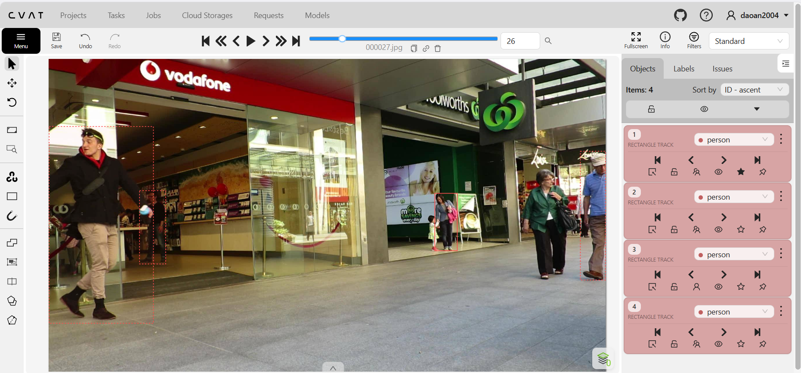
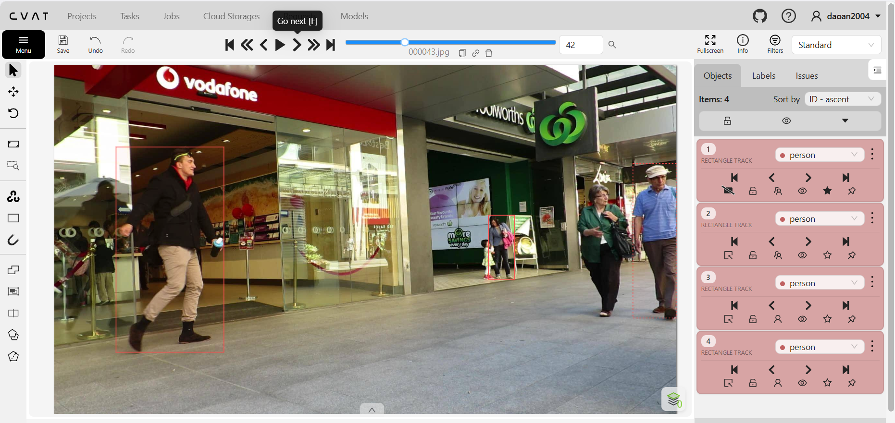
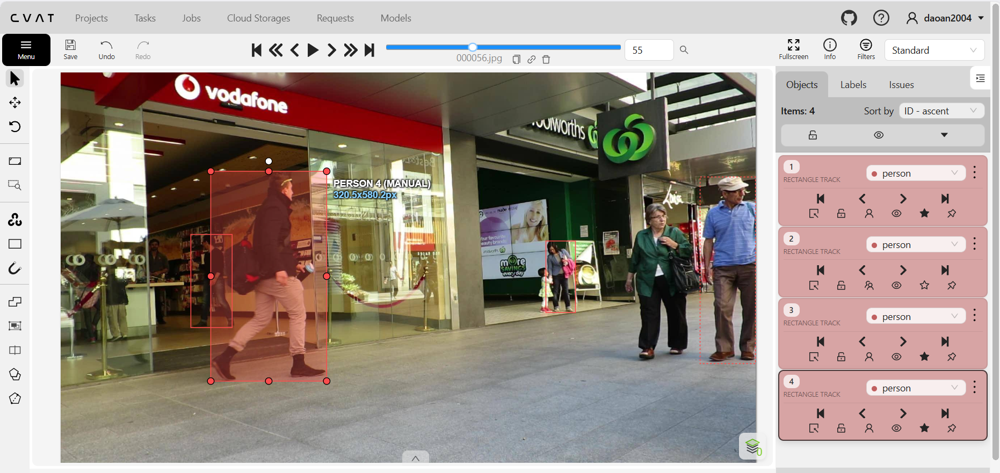

# Báo cáo cá nhân — Đào Bình An — 2A202603264

Trong bài lab này, mình dùng CVAT chạy trên máy cá nhân để gán nhãn tracking cho 5 người trong chuỗi MOT17-09. Mình vẽ bằng Rectangle ở chế độ Track, chỉnh box tại các keyframe và dùng nội suy để giảm số lần phải chỉnh tay.

Báo cáo này được tổng hợp từ quá trình làm bài và hai file xuất hiện tại. Những chỗ chưa hoàn thành mình ghi rõ, thay vì coi kết quả không lỗi định dạng là nhãn đã đúng hết.

## 0. Thông tin học viên

- Họ tên: Đào Bình An.
- MSSV: **2A202603264**.
- Mã đề: **C**.
- Email: daoan2004@gmail.com.
- Link repository bài nộp: [K5-L2-DaoBinhAn-2A202603264-MOTTracking](https://github.com/daoan2004/K5-L2-DaoBinhAn-2A202603264-MOTTracking).
- Tên repository: `K5-L2-DaoBinhAn-2A202603264-MOTTracking`.
- Giờ bắt đầu: **4h30 ngày 13/11/2026 (GMT+7)**.
- Giờ kết thúc: **6h30 ngày 13/11/2026 (GMT+7)**.
- Thời gian từ bắt đầu đến kết thúc: **2 giờ (120 phút)**.
- Job thực hành: [CVAT local — Job 14](http://localhost:8080/tasks/14/jobs/14).
- Dữ liệu: MOT17-09, 150 frame liên tiếp, 1920 × 1080, 30 fps.
- Ngày tổng hợp báo cáo và kiểm tra bản xuất: **14/11/2026**.

Mình dùng số frame theo CVAT, từ **0 đến 149**. Trong `gt/gt.txt`, số frame tương ứng là 1 đến 150.

Đề C trong `src/lab_variants.json` giao các MOT ID gốc `[1, 7, 20, 22, 23]`, tương ứng P1–P5 theo thứ tự. Mình đối chiếu người bằng bảng nhận diện do script tạo. Các ID được đánh lại trong file xuất khác với mã P1–P5 và ID hiển thị trên CVAT:

| Mã người | ID trong XML CVAT | ID trong MOT đã xuất |
|---|---:|---:|
| P1 | 0 | 1 |
| P2 | 4 | 5 |
| P3 | 1 | 2 |
| P4 | 2 | 3 |
| P5 | 3 | 4 |

## 1. Xem trước đoạn video (CP0)

Qua đoạn video, mình nhận diện P1 là người áo đen trong cửa hàng Vodafone; P2 là người áo sáng có dải cam đứng gần cửa kính bên trái; P3 là người áo polo xanh đội mũ; P4 là người mang túi hồng cạnh em bé; P5 là người áo khoác đen, quần be đi ngang phía trước.

Mình chưa ghi đầy đủ nhật ký xem trước ngay từ đầu. Vì vậy, bảng dưới là số liệu tổng hợp sau khi gán từ bản xuất hiện tại. Hai cột đầu/cuối nói về **frame có box trong file**, chưa thay thế việc xác nhận frame đầu/cuối nhìn thấy người trong ảnh.

| Mã | Frame có box đầu tiên | Frame có box cuối cùng | Frame được đánh dấu occluded | Đoạn không có box trong bản xuất |
|---|---:|---:|---|---|
| P1 | 0 | 149 | 25–54; 98–111 | Không có |
| P2 | 61 | 149 | 61–100 | 0–60: track chưa bắt đầu |
| P3 | 0 | 149 | 0–64 | Không có |
| P4 | 0 | 139 | 89–107; 123–139 | 108–122 và 140–149 |
| P5 | 0 | 149 | 0–36; 109–119; 122–136; 148–149 | 120–121 và 137–147 |

Mình chưa ghi riêng các frame bắt đầu rẽ, dừng hoặc đổi tốc độ. Điểm cần xem lại là P2: track đang bắt đầu ở frame 61, trong khi frame 61 chỉ là mốc nhận diện trong ảnh hướng dẫn. Nếu P2 đã nhìn thấy ở các frame trước đó thì phần nhãn này còn thiếu.

## 2. Keyframe và thời gian (CP1, CP4)

Mình lấy số keyframe từ `src/check_submission.py`, dựa trên file `DaoBinhAn_cvat_video.zip`. Số frame ở đây là số frame có box với `outside=0` trong bản xuất.

| Mã | Số keyframe | Số frame có box | Keyframe / 100 frame | Thời gian (phút) | Chỗ khó |
|---|---:|---:|---:|---|---|
| P1 | 62 | 150 | 41.3 | Chưa ghi riêng | Theo người áo đen trong shop; cần phân biệt che một phần với khuất hẳn. |
| P2 | 18 | 89 | 20.2 | Chưa ghi riêng | Người áo sáng có dải cam trong shop; bản hiện tại mới có nhãn từ frame 61. |
| P3 | 22 | 150 | 14.7 | Chưa ghi riêng | Người áo polo xanh, đội mũ; kích thước box tăng khi lại gần camera. |
| P4 | 21 | 125 | 16.8 | Chưa ghi riêng | Người mang túi hồng cạnh em bé; có đoạn bị người phía trước che. |
| P5 | 88 | 137 | 64.2 | Chưa ghi riêng | Người áo khoác đen, quần be đi ngang; số keyframe còn dày. |
| **Tổng** | **211** | **651** | **32.4** | **120 (cả buổi)** | |

Keyframe / 100 frame của cả bài = 211 ÷ 651 × 100 ≈ **32,4**.

P5 có nhiều keyframe nhất, với 88 keyframe. Người này đi ngang từ mép trái sang bên phải và có những đoạn bị che bởi người đi phía trước. Trong lúc làm mình chỉnh box khá dày, nên bản xuất vẫn còn cảnh báo **64,2 keyframe / 100 frame**, vượt ngưỡng 50 của lớp. Mật độ cao này chưa chứng minh box chính xác hơn; mình vẫn cần kiểm tra xem có mốc nào bỏ được mà box nội suy vẫn bám đúng người.

Thời gian cả buổi của mình là 120 phút, từ 4h30 đến 6h30 ngày 13/11/2026. Mình chưa ghi riêng thời gian từng người nên chỉ điền tổng thời gian cả buổi, không chia đều hoặc ước lượng số phút cho từng track.

Danh sách keyframe theo frame CVAT:

<details>
<summary>P1: 62 keyframe</summary>

0, 5, 10, 19, 21, 22, 24, 25, 26, 27, 28, 36, 55, 56, 57, 58, 61, 63, 64, 66, 70, 75, 76, 77, 78, 80, 85, 88, 90, 92, 93, 97, 98, 99, 100, 101, 102, 103, 104, 105, 106, 107, 108, 109, 110, 112, 113, 114, 115, 116, 117, 118, 119, 120, 130, 140, 142, 143, 144, 146, 147, 149.

</details>

<details>
<summary>P2: 18 keyframe</summary>

61, 64, 70, 80, 84, 90, 100, 101, 102, 103, 104, 105, 106, 110, 120, 130, 140, 149.

</details>

<details>
<summary>P3: 22 keyframe</summary>

0, 10, 20, 30, 40, 50, 60, 65, 66, 70, 71, 78, 79, 80, 90, 100, 110, 120, 130, 131, 140, 149.

</details>

<details>
<summary>P4: 21 keyframe</summary>

0, 5, 21, 24, 25, 29, 34, 41, 50, 55, 59, 65, 70, 73, 81, 84, 88, 89, 90, 123, 136.

</details>

<details>
<summary>P5: 88 keyframe</summary>

0, 1, 2, 3, 4, 5, 6, 9, 12, 16, 19, 21, 25, 27, 29, 33, 36, 37, 38, 41, 45, 47, 49, 50, 52, 53, 55, 58, 59, 60, 61, 62, 63, 64, 66, 68, 70, 74, 75, 76, 77, 80, 83, 84, 85, 86, 87, 89, 90, 93, 94, 95, 96, 97, 100, 102, 103, 104, 105, 107, 108, 109, 110, 111, 112, 113, 114, 115, 116, 117, 118, 119, 122, 123, 124, 125, 126, 127, 128, 129, 130, 131, 132, 133, 134, 136, 148, 149.

</details>

## 3. Đoạn bị che (CP2)

Người mình chọn để trình bày là **P1**: người áo đen bên trong cửa hàng. Trong bộ ảnh minh chứng bên dưới, P1 mang **ID 1 trên CVAT**; trong hai ZIP đang lưu ở repo tương ứng XML track 0 và MOT track 1.

P1 bị người áo khoác đen, quần be đi phía trước che. Mình giữ cùng track cho P1 trước và sau đoạn che. Người hiện lại có ngoại hình và vị trí phù hợp với người đang đi trong shop; đoạn che đầu tiên ngắn hơn ngưỡng 60 frame của lớp.

Các mốc dưới đây phân biệt **cờ trong hai ZIP hiện tại** với **trạng thái chụp trên CVAT sau đó**:

| Mốc | Trạng thái trong bản xuất |
|---|---|
| Bắt đầu đoạn occluded đầu tiên | Frame 25 |
| Mất hẳn, cần bật outside | Ảnh frame 42 cho thấy outside đã bật trên CVAT; hai ZIP hiện tại vẫn ghi `outside=0`, `occluded=1` ở frame này |
| Hiện lại, cần tắt outside | Ảnh frame 55 cho thấy box P1 xuất hiện lại; chưa xác nhận frame đầu tiên hiện lại và cặp mốc outside trong bản xuất mới |
| Tắt occluded của đoạn đầu tiên | Frame 55 |
| Đoạn occluded khác trong file | Frame 98–111 |

Đoạn occluded đầu tiên trong file là 25–54, tức 30 frame, tương đương **1 giây**. Đây là thời gian đánh dấu che khuất trong bản hiện tại, không có nghĩa P1 mất hoàn toàn suốt 30 frame. Mình chưa chốt số frame khuất hẳn để điền một thời gian chính xác cho phần đó.

Trong hai ZIP hiện tại, mình đã dùng `occluded` cho cả một đoạn có lúc P1 khuất hẳn. Ảnh minh chứng mới ở frame 42 cho thấy mình đã bật `outside` trên CVAT và box P1 được ẩn. Tuy nhiên, thay đổi này chưa có trong hai ZIP đang lưu ở repo, nên mình còn cần lưu và xuất lại cả hai định dạng để đồng bộ với ảnh. Quy ước áp dụng là còn thấy một phần thì dùng `occluded` và box toàn thân ước lượng; mất hoàn toàn thì bật `outside`; hiện lại thì tắt `outside` trên cùng track.

Ba ảnh minh chứng đã được lưu trong `report/individual/images/`. Số frame trong các ảnh là **26 → 42 → 55**.

### Ảnh 1 — Frame 26: trước khi P1 khuất hẳn



Ở frame 26, P1 vẫn còn nhìn thấy một phần bên trong shop và box có viền nét đứt. Ảnh này thể hiện thời điểm trước khi khuất hẳn; P1 đã bắt đầu bị che một phần.

### Ảnh 2 — Frame 42: P1 khuất hoàn toàn



Ở frame 42, người đi phía trước che hoàn toàn P1. Box P1 không hiển thị trên ảnh, còn track ID 1 vẫn có trong panel Objects với cờ outside bật.

### Ảnh 3 — Frame 55: P1 hiện lại



Ở frame 55, box nhỏ của P1 đã xuất hiện lại trong shop và P1 vẫn thuộc track ID 1 trong bộ ảnh này. Object đang được chọn và tô nổi bật là **P5, ID 4**, người áo khoác đen, quần be đi phía trước.

Nguồn ba ảnh: MOT17, MOTChallenge (Milan et al., 2016).

## 4. Tự review ID (CP3)

Trong quá trình làm, mình có kiểm tra lại các ảnh thao tác và đối chiếu hai file xuất với sự hỗ trợ của ChatGPT/Codex. Mình chưa có nhật ký ghi riêng hai lượt review theo người và theo cảnh, nên chưa khẳng định đã hoàn thành đủ hai lượt theo yêu cầu CP3.

Bảng dưới ghi những vấn đề đã được phát hiện trong quá trình trao đổi và kiểm tra. Cột phát hiện ghi đúng cách tìm thấy, thay vì điền lượt 1 hoặc lượt 2 khi mình chưa ghi lại.

| Frame | Mã người | Loại lỗi | Mô tả | Phát hiện ở lượt / cách kiểm tra | Đã sửa? |
|---|---|---|---|---|---|
| 61 | P1 | `drift` | Ở ảnh thao tác trước đó, box P1 còn lệch về vị trí cũ khi người đã đi sang phải. | Trong lúc gán, đối chiếu ảnh và hướng dẫn thao tác | Đã chỉnh vị trí tại frame 61 trong bản xuất hiện tại; chưa kết luận mọi frame đều hết drift. |
| Các frame có track người áo xanh lá trong bản xuất trước | Ngoài P1–P5 của đề C | `false_track` | Mình đã gán nhầm người áo xanh lá, trong khi đề C yêu cầu P2 ở cửa shop. | Đối chiếu bảng nhận diện và kiểm tra bản xuất cùng trợ lý AI | Đã bỏ track người áo xanh lá và bổ sung đúng người P2 ở bản xuất mới. |
| 42 | P1 | `flag` | P1 khuất hẳn nhưng hai ZIP hiện tại vẫn để occluded, chưa bật outside. | Kiểm tra ảnh và đọc cờ trong XML | Ảnh mới cho thấy outside đã bật trên CVAT; chưa xuất lại hai ZIP để cập nhật thay đổi này. |

Tổng hợp **các lỗi đã ghi trong bảng**, không phải số lỗi đo được trên toàn bộ job:

| `id_switch` | `fragmentation` | `lost` | `merge` | `false_track` | `drift` | `flag` |
|---:|---:|---:|---:|---:|---:|---:|
| 0 | 0 | 0 | 0 | 1 | 1 | 1 |

Ngoài các dòng đã xác định trên, P2 chưa có box trước frame 61 nên mình còn cần tua lại đoạn 0–60 để xác nhận phần nào là bỏ sót (`lost`). Mình chưa đưa một số lượng lỗi lost vào bảng khi chưa kiểm tra đủ đoạn này.

Với câu hỏi lỗi nào chỉ lượt 2 mới thấy, mình chưa có đủ ghi chép để so sánh trung thực hai lượt. Qua lần đối chiếu toàn bộ 5 người với bảng nhận diện, mình thấy việc nhìn từng box riêng dễ bỏ qua chuyện đã chọn nhầm một người ngoài đề.

## 5. File xuất và kết quả tự kiểm (CP4)

| Kiểm tra | Kết quả |
|---|---|
| File MOT 1.1 | `src/exports/DaoBinhAn_mot.zip`, có `gt/gt.txt` và `gt/labels.txt` |
| File CVAT for video 1.1 | `src/exports/DaoBinhAn_cvat_video.zip`, có `annotations.xml` |
| Số track ID trong MOT | **5** |
| Tổng số box trong MOT | **651** |
| Tổng số keyframe | **211** |
| Lỗi / cảnh báo của script | **0 lỗi định dạng / 1 cảnh báo** |
| Ảnh gốc trong hai ZIP | Không có |
| Ba ảnh minh chứng | Đã có trong `images/`, ở các frame 26, 42 và 55 |
| Đối chiếu frame và track có box giữa MOT và XML | Khớp nhau trong hai file hiện tại |
| Frame outside không có dòng trong MOT | Đúng với các frame không có box đã đối chiếu; việc đặt cờ đúng với cảnh thật vẫn cần kiểm tra |
| Job đã completed trên CVAT | Chưa xác nhận trực tiếp; file xuất không cung cấp trạng thái này |

Lệnh mình dùng để kiểm tra từ thư mục gốc:

```powershell
.\.venv\Scripts\python.exe src/check_submission.py --mot src/exports/DaoBinhAn_mot.zip --cvat src/exports/DaoBinhAn_cvat_video.zip
```

Kết quả của lần kiểm tra bản xuất hiện tại:

```text
Số frame in theo CVAT (bắt đầu từ 0). Trong gt.txt, frame_id = frame CVAT + 1.

=== File MOT 1.1: DaoBinhAn_mot.zip ===
  Số track ID: 5   |   Tổng số box: 651
  [OK]        Đúng 5 track ID.

  Track | Frame có mặt | Số frame | Đoạn vắng (outside)
      1 |   0–149      |      150 | -
      2 |   0–149      |      150 | -
      3 |   0–139      |      125 | 108–122
      4 |   0–149      |      137 | 120–121, 137–147
      5 |  61–149      |       89 | -


=== File CVAT for video 1.1: DaoBinhAn_cvat_video.zip ===

  Track | Nhãn   | Frame thấy | Keyframe | KF/100 frame | Frame occluded | Lần bật outside
      0 | person |        150 |       62 |         41.3 |             44 |               0
              Track 0: keyframe ở frame [0, 5, 10, 19, 21, 22, 24, 25, 26, 27, 28, 36, 55, 56, 57, 58, 61, 63, 64, 66, 70, 75, 76, 77, 78, 80, 85, 88, 90, 92, 93, 97, 98, 99, 100, 101, 102, 103, 104, 105, 106, 107, 108, 109, 110, 112, 113, 114, 115, 116, 117, 118, 119, 120, 130, 140, 142, 143, 144, 146, 147, 149]
      1 | person |        150 |       22 |         14.7 |             65 |               0
              Track 1: keyframe ở frame [0, 10, 20, 30, 40, 50, 60, 65, 66, 70, 71, 78, 79, 80, 90, 100, 110, 120, 130, 131, 140, 149]
      2 | person |        125 |       21 |         16.8 |             36 |               2
              Track 2: keyframe ở frame [0, 5, 21, 24, 25, 29, 34, 41, 50, 55, 59, 65, 70, 73, 81, 84, 88, 89, 90, 123, 136]
      3 | person |        137 |       88 |         64.2 |             65 |               2
              Track 3: keyframe ở frame [0, 1, 2, 3, 4, 5, 6, 9, 12, 16, 19, 21, 25, 27, 29, 33, 36, 37, 38, 41, 45, 47, 49, 50, 52, 53, 55, 58, 59, 60, 61, 62, 63, 64, 66, 68, 70, 74, 75, 76, 77, 80, 83, 84, 85, 86, 87, 89, 90, 93, 94, 95, 96, 97, 100, 102, 103, 104, 105, 107, 108, 109, 110, 111, 112, 113, 114, 115, 116, 117, 118, 119, 122, 123, 124, 125, 126, 127, 128, 129, 130, 131, 132, 133, 134, 136, 148, 149]
  [CẢNH BÁO]  Track 3: 64 keyframe / 100 frame > 50. Quá dày, dồn keyframe vào chỗ rẽ / dừng / bị che.
      4 | person |         89 |       18 |         20.2 |             40 |               0
              Track 4: keyframe ở frame [61, 64, 70, 80, 84, 90, 100, 101, 102, 103, 104, 105, 106, 110, 120, 130, 140, 149]

  Tổng: 211 keyframe / 651 frame có mặt = 32.4 keyframe / 100 frame
  [OK]        Đọc được 5 track từ annotations.xml.

=== Tóm tắt ===
  Lỗi: 0   |   Cảnh báo: 1
  Không có lỗi định dạng. Mở CVAT xem lại từng [CẢNH BÁO]; cảnh báo đúng ý bạn thì ghi lý do vào báo cáo.
```

Bản log riêng nằm ở [check_submission.txt](check_submission.txt).

Mình hiểu kết quả 0 lỗi ở đây là không có lỗi mà script kiểm được về định dạng và cấu trúc. Script không có ground truth nên không thể xác nhận mọi box đúng người, không tính MOTA/IDF1 và không thay thế review bằng mắt.

Các hạn chế còn lại của bản hiện tại:

- Hai ZIP chưa cập nhật cờ outside của P1 như ảnh chụp CVAT ở frame 42.
- P2 mới có nhãn từ frame 61; phần trước đó cần xem lại.
- P5 vẫn còn cảnh báo keyframe quá dày.
- Chưa xác nhận trạng thái completed trên CVAT.

## 6. Ba câu kết

1. **Nếu được gán lại, mình sẽ đặt keyframe khác ở đâu? Vì sao?**

   Mình sẽ xem trước kỹ hơn rồi tập trung keyframe vào chỗ đổi hướng, thay đổi kích thước và ngay trước/sau đoạn bị che. Với P5, mình sẽ kiểm tra các đoạn đi đều để bỏ bớt mốc dư, vì 88 keyframe trên 137 frame có box đang quá dày. Với P1, mình cần xử lý đúng ranh giới giữa che một phần và mất hẳn, chứ chỉ chỉnh box hoặc thêm keyframe chưa giải quyết được lỗi cờ.

2. **Có chỗ nào mình không chắc cùng ID hay ID mới? Mình đã quyết định và ghi chú thế nào?**

   Chỗ khiến mình phải hỏi lại là khi P1 bị người đi phía trước che. Mình giữ cùng track cho P1 vì đoạn che ngắn và người hiện lại vẫn khớp ngoại hình, vị trí và hướng di chuyển trong shop. Ảnh mới ở frame 42 đã thể hiện cờ outside bật, nhưng mình còn cần xuất lại hai ZIP và xác nhận đúng mốc bắt đầu, kết thúc đoạn khuất hẳn. Mình ghi rõ trạng thái này ở mục 3.

3. **Một lỗi trong bài có thể làm xe tự lái dự đoán sai chuyển động như thế nào? Lỗi đó ảnh hưởng MOTA hay IDF1 nhiều hơn?**

   Lỗi chọn nhầm người áo xanh lá làm bài vừa thiếu nhãn của P2 vừa có nhãn cho người ngoài danh sách cần theo dõi. Nếu một hệ thống dùng các nhãn đó, nó có thể học hoặc đánh giá sai việc phát hiện và theo dõi người cần quan sát. FN và FP ảnh hưởng trực tiếp đến MOTA; việc thiếu cả track đúng cũng làm IDF1 giảm. Mình không có kết quả chấm với GT nên chưa kết luận chỉ số nào giảm nhiều hơn trong bài này. Với trường hợp đổi ID kéo dài giữa hai người, IDF1 sẽ thể hiện rõ vấn đề giữ danh tính theo thời gian, dù MOTA có thể vẫn khá cao.

## Bonus

Mình chưa thực hiện các mục bonus trong bản báo cáo này.

## 7. Tài liệu tham khảo và công cụ AI đã dùng

- MOT17, MOTChallenge (Milan et al., 2016), giấy phép CC BY-NC-SA 3.0 theo tài liệu bài lab.
- [README của bài lab](../../README.md).
- [Quy ước gán nhãn](../../docs/GUIDELINE.md).
- [Bảng phím tắt CVAT](../../docs/CVAT_CHEATSHEET.md).
- [Định dạng MOT, MOTA và IDF1](../../docs/MOT_FORMAT.md).
- [Cấu hình đề A/B/C](../../src/lab_variants.json).
- [Yêu cầu bài nộp](../../SUBMISSION.md).
- Công cụ: CVAT Community local, Python, `src/setup_local_lab.py` và `src/check_submission.py`.
- AI đã dùng: ChatGPT/Codex để hướng dẫn cài môi trường, thao tác CVAT, phân biệt occluded/outside, đối chiếu ảnh nhận diện, đọc và giải thích file xuất, thống kê số liệu và hỗ trợ soạn báo cáo từ dữ liệu thực tế. 
